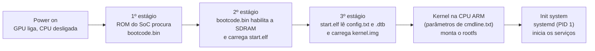

# SEL0337 – Prática 5: systemd e Git/GitHub

**Projetos em Sistemas Embarcados – EESC/USP**

| Integrante | Nº USP |
|---|---|
| Eduardo Matheus Cardoso | 14567242 |
| Cauã Sanchez Fernandes | 14754734 |

Placa: Raspberry Pi 3 Model B+ (Rev 1.3) · Raspberry Pi OS (Debian 13 trixie, 64 bits) · kernel 6.1.54

---

## Estrutura do repositório

```
SEL0337-Pratica5/
├── README.md
├── .gitignore
├── historico_git.txt              # saída de "git log" (gerada na Raspberry Pi)
├── checkpoint1/
│   ├── blink_led.py               # aplicação: pisca LED na GPIO18
│   ├── blink_off.py               # programa do ExecStop
│   ├── blink_python.service       # unit file do systemd
│   └── exemplo_bash/
│       ├── blink.sh               # exemplo do roteiro (GPIO via sysfs)
│       └── blink.service
└── imagens/                       # fotos e prints da montagem e do funcionamento
```

---

## Checkpoint 1 – Serviço personalizado no systemd

### Objetivo

Fazer uma aplicação em Python iniciar sozinha no boot da Raspberry Pi, sem que ninguém precise logar e executá-la pelo terminal. Isso é feito registrando a aplicação como uma *service unit* do **systemd**.

### Conceitos envolvidos

**Boot da Raspberry Pi.** No BCM2837B0 quem liga primeiro é a GPU (VideoCore), não a CPU ARM. A partir daí o controle passa por três estágios de bootloader, todos lidos da partição `boot` (FAT32) do cartão microSD, até o kernel assumir e montar a partição `rootfs` (ext4):



**Init system e systemd.** O *init system* é o primeiro processo de espaço de usuário (PID 1) e é responsável por iniciar e encerrar todos os serviços do sistema operacional. O **systemd** substituiu o SysVinit (scripts shell em `/etc/init.d`) na maioria das distribuições: inicia serviços em paralelo, controla dependências entre eles e agrupa processos em *cgroups*. O utilitário **systemctl** é a interface de linha de comando para iniciar, parar, habilitar e verificar o estado dos serviços.

**Unit file (`.service`).** Arquivo de texto que diz ao systemd como gerenciar o serviço:

| Seção | Chave usada | Função |
|---|---|---|
| `[Unit]` | `Description` | Texto exibido no boot: `[ OK ] Started ...` |
| | `After=multi-user.target` | Só inicia depois que o sistema multiusuário estiver pronto |
| `[Service]` | `ExecStart` | Comando executado ao iniciar (interpretador Python + script) |
| | `ExecStop` | Comando executado em `systemctl stop` |
| | `User=sel` | Usuário sem privilégios de root que roda o processo |
| | `Restart=on-failure` | Reinicia o programa se ele terminar com erro |
| `[Install]` | `WantedBy=multi-user.target` | Faz `systemctl enable` ligar o serviço ao boot |

### Aplicação escolhida

Blink de LED em Python, reaproveitando o circuito da Prática 3:

| Componente | Ligação |
|---|---|
| LED (anodo) | GPIO18 – pino físico 12, via resistor de 330 Ω |
| LED (catodo) | GND – pino físico 14 |

- **`blink_led.py`** pisca o LED a 1 Hz. Trata o sinal `SIGTERM` (enviado pelo `systemctl stop`) para sair do laço, apagar o LED e liberar a GPIO de forma limpa.
- **`blink_python.service`** chama o próprio interpretador Python do ambiente virtual (`/home/sel/4234/bin/python`) em `ExecStart`, já que o script depende dele e das suas bibliotecas para executar.
- **`blink_off.py`** é o programa do `ExecStop`. Como o systemd executa o `ExecStop` *antes* de encerrar o processo principal, ele recebe o PID do serviço (`$MAINPID`), encerra o `blink_led.py`, espera ele terminar (assim os dois não disputam a GPIO18), pisca o LED 3 vezes rapidamente para indicar a parada, deixa o LED apagado e registra a data/hora em `paradas_servico.log`.

### Como instalar e testar

```bash
sudo cp blink_python.service /lib/systemd/system/
sudo systemctl daemon-reload
sudo systemctl start blink_python      # LED começa a piscar
sudo systemctl stop blink_python       # executa o blink_off.py
sudo systemctl enable blink_python     # passa a iniciar no boot
sudo reboot
systemctl status blink_python          # verificação / erros
```

### Resultados

<!-- Substituir pelos arquivos reais enviados para a pasta imagens/ -->

**Montagem prática:**


**Boot da Raspberry Pi com o serviço iniciado (`[ OK ] Started Blink LED em Python`):**


**Saída de `systemctl status blink_python`:**


---

## Checkpoint 2 – Git e GitHub

O repositório foi clonado na Raspberry Pi (`/home/sel/git_projects`) e todo o código desta prática foi versionado a partir da própria placa, com o fluxo:


Comandos explorados: `git config`, `git clone`, `git add`, `git commit -m`, `git push`, `git pull`, `git reset`, `git checkout`, `git rm`, `.gitignore` e `git log`. O histórico completo de commits está em [`historico_git.txt`](historico_git.txt) (gerado com `git log > historico_git.txt`).

O `.gitignore` impede que entrem no repositório o cache do Python, os logs e qualquer arquivo de token do GitHub.
